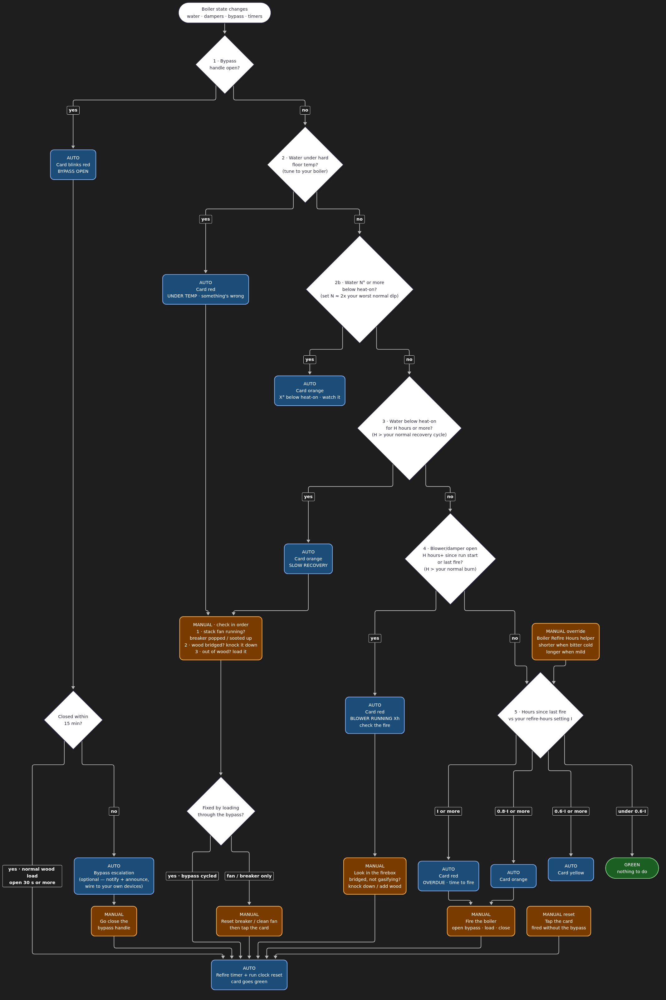

# HA Boiler Monitoring Kit

One Home Assistant package + one dashboard card that answers a single
question at a glance: **does the boiler need me right now?**

Built for an outdoor wood boiler, but the rules don't care what's behind the
five entities it reads — any boiler or furnace that can expose a water temp,
a setpoint, a differential, and a "the fire is actively being tended" signal
fits. Five rules, evaluated top to bottom, first match wins, tuned from real
history instead of guessed thresholds. Full writeup and flowchart:
[`docs/boiler-monitoring-logic.md`](docs/boiler-monitoring-logic.md).

> **Not a safety device.** This is a convenience dashboard layered on top of
> whatever safety hardware your boiler already has (low-water cutoffs,
> pressure relief, CO detectors, etc.) — it does not replace any of them, and
> it can be wrong if a sensor fails or an entity goes `unavailable`. Treat a
> quiet dashboard as "nothing to report," not as a guarantee.

<a href="docs/boiler-monitoring-logic.svg"></a>

## What you get

- **`packages/boiler_monitoring.yaml`** — one drop-in package. Helpers
  (refire timer + four tunable thresholds), two automations that keep the
  rule clocks honest with no manual steps, a manual-reset script, and a
  `sensor.boiler_status` template sensor that is the single source of truth
  for "what should the card say right now."
- **`custom_templates/boiler_monitoring.jinja`** — the rule chain itself, as
  one Jinja macro every other template calls, so the dashboard and the sensor
  can never disagree with each other. See the file's own header for why this
  is a macro instead of logic copy-pasted into the sensor's `state:` and
  `attributes:` blocks (short version: HA renders those as separate
  templates, and a sensor reading its *own* previous state back is a classic
  one-cycle-lag bug).
- **`lovelace/boiler-card-native.yaml`** — a dashboard card using only core
  Lovelace cards. **No HACS required.**
- **`lovelace/boiler-card-button-card.yaml`** — the same data in a single
  bigger, color-filled tile, if you already run (or don't mind adding) the
  [button-card](https://github.com/custom-cards/button-card) HACS card.
- **`dashie/`** — optional. A ring-gauge wall-tablet tile for anyone running
  [Dashie](https://github.com/jcwillox/dashie) as a kiosk dashboard. Not a
  requirement — see that folder's own README.

## Install

1. **Make sure your `configuration.yaml` loads packages:**
   ```yaml
   homeassistant:
     packages: !include_dir_named packages
   ```
2. Copy `packages/boiler_monitoring.yaml` into `<config>/packages/`.
3. Copy `custom_templates/boiler_monitoring.jinja` into
   `<config>/custom_templates/` (create the folder if it doesn't exist — HA
   auto-loads every `.jinja` file there, no YAML wiring needed).
4. **Wire up the five entities this kit expects** (see the table below) —
   either by renaming your own boiler integration's entities to match, or by
   adding five thin template sensors that map your real entities onto these
   names. If you don't already have these from your boiler controller, start
   with whatever your controller/PLC/Modbus/ESPHome setup can expose; the
   kit only needs numbers and an on/off, not a specific protocol.
5. Restart Home Assistant (packages and custom_templates both need a restart
   to pick up new files, not just a reload).
6. Check `sensor.boiler_status` in Developer Tools → States. It should read
   one of: `bypass_open`, `low_water`, `under_floor`, `below_band_watch`,
   `slow_recovery`, `blower_running`, `overdue`, `fire_soon`, `due_later`,
   `ok`.
7. **Before you trust any of it: retune the four threshold `input_number`
   helpers to your own boiler.** The shipped defaults came from one specific
   boiler's three-day history and are almost certainly wrong for yours — see
   "Tuning the thresholds" in `docs/boiler-monitoring-logic.md`. Skipping this
   step is the single most common way this goes red on every normal heat
   cycle.
8. Add a card: paste `lovelace/boiler-card-native.yaml` into a dashboard view
   in YAML mode (no extra install), or `lovelace/boiler-card-button-card.yaml`
   if you have the button-card HACS integration.

### The five entities this kit expects

| Entity | Role | Required? |
|---|---|---|
| `sensor.boiler_water_temp` | Current boiler water temp | yes |
| `sensor.boiler_set_water_temp` | The boiler's own setpoint | yes |
| `sensor.boiler_differential` | The boiler's own on/off differential (band = set − differential) | yes |
| `sensor.boiler_bottom_damper` | >0 while the fire is actively being driven (damper/blower) | yes |
| `binary_sensor.boiler_bypass_door_open` | On while the loading/bypass door is open | yes |
| `binary_sensor.boiler_low_water_alarm` | On when a low-water float/alarm trips | optional — omit it, that branch never fires |

Don't have a boiler controller that already exposes these as HA entities? You
need *some* way to get temps and an on/off into HA — a REST sensor against
your controller's own API, MQTT, Modbus, or an ESPHome node reading an
analog/digital input are all fine. This kit starts downstream of that: once
you have the five entities, the rest is drop-in.

## Why no boiler-api server is in this repo

The original build also had a small Flask service that polled a specific
PLC's own API and recorded history to a database, with its own dashboard
"History" tab. **That piece is deliberately NOT part of this kit** — it's
specific to one PLC vendor's protocol, and Home Assistant's own built-in
History panel already gives you a history graph for every entity here with
zero extra server to run or maintain. Add a
[`history-graph`](https://www.home-assistant.io/dashboards/history-graph/)
card for `sensor.boiler_water_temp` if you want a graph on the same
dashboard — that's a few lines of core Lovelace config, not a service to
deploy.

If your own boiler controller needs something more custom than HA's REST/
MQTT/Modbus integrations can reach, that's a per-install project — this kit
doesn't assume one.

## Keeping this repo clean — the secret-scan gate

`scripts/scan.sh` runs [gitleaks](https://github.com/gitleaks/gitleaks)
(generic secret patterns) plus a small denylist for RFC1918 address ranges
and a couple of personal names that have no business in a public dashboard
kit. It runs in CI on every push and PR (`.github/workflows/secret-scan.yml`)
and you can run it locally before committing:

```sh
./scripts/scan.sh
```

See `CONTRIBUTING.md` for wiring it up as a local pre-commit hook.

## License

MIT — see `LICENSE`.
