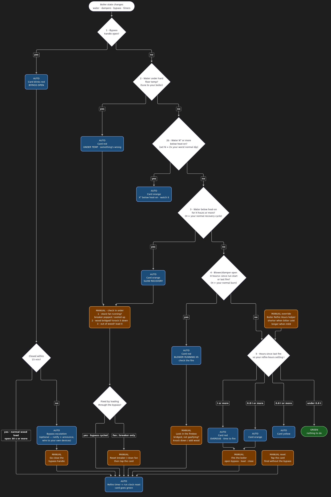

# Boiler monitoring logic — the "boiler status" card

Originally built for an outdoor wood boiler on a PLC controller, but the rules
below don't care what's behind `sensor.boiler_water_temp` — any boiler/furnace
that exposes a water temp, a setpoint, a differential, and a "the fire is
being tended" signal (a bypass/loading door, a blower/damper) fits. One card
that answers, at a glance: **does the boiler need me right now?**

Rules are evaluated **top to bottom; first match wins** — see
`custom_templates/boiler_monitoring.jinja`'s `boiler_word()` macro, which is
the executable version of this chart.

*Pre-rendered so nothing truncates — click for the full-size SVG. The
live-editable Mermaid source is in `boiler-monitoring-logic.mmd` (re-render:
`mmdc -i boiler-monitoring-logic.mmd -o boiler-monitoring-logic.svg -b "#1e1e1e"`).*

**Legend:** blue = automated (card color/text changes, no one touches
anything) · brown = manual (someone goes to the boiler) · green = all good.

## Why first-match-wins, not a bag of independent alerts

A single ranked state is what makes the card readable at a glance: the household
checks ONE color, not six badges. The ranking is deliberately the one in the
chart — a hardware safety fault (bypass open, low water) always outranks a
"this is just a slow day" reading, and "you're overdue to fire it" is the
lowest-priority rule because it's the one that's wrong most often (everything
else in the chain already ruled out a real problem).

## Tuning the thresholds to YOUR boiler

Every threshold below ships as an `input_number` in
`packages/boiler_monitoring.yaml` — nothing here requires editing YAML to
retune. **Don't ship with the defaults untouched.** They were tuned against
three days of real history on one specific boiler and WILL go red on every
normal heat call on a different one if you don't repeat the exercise:

1. Let the kit run a few days with the thresholds wide open (hard floor low,
   watch-offset/hours generous) so nothing fires falsely.
2. Pull the history for `sensor.boiler_water_temp` and your damper/blower
   sensor over that window (HA's own History panel is enough — no extra
   server needed).
3. Find: how far does water normally dip below the on/off band before
   recovering? How long does a normal below-band period last? How long does a
   normal burn run the blower?
4. Set `Boiler Below-Band Watch Offset` to roughly 2x the worst *normal* dip,
   `Boiler Below-Band Hours` and `Boiler Blower Hours` to comfortably above
   the worst *normal* duration, and `Boiler Hard Floor Temp` to a water temp
   that is unambiguously "something is wrong", not "mid-cycle".

The original tuning note, kept here as a worked example (your numbers will
differ): on that boiler, water crossing the on/off band kept falling
41–88 minutes before recovering, bottoming out ≤4.4°F below the band on a
normal cycle; below-band periods ran ≤137 minutes normally; blower runs ran
33–90 minutes, up to 150 right after loading. The real faults in the same
window were a blower pinned for 385 and 520 minutes, and 352 minutes below
band. So: hard floor well below the band, watch-offset ≈2x the worst normal
dip, below-band-hours and blower-hours comfortably above the worst normal
duration. None of those trip on a normal cycle; all of them catch the actual
faults. Revisit if your differential or setpoint changes a lot.

## Failure modes and which rule catches them

| Failure | What actually happens | Caught by | Speed |
|---|---|---|---|
| Bypass/loading door left open | Draft runs through the bypass instead of the fire; fire smolders or goes out | Rule 1 (instant) + an optional escalation automation you wire to your own notify targets | Instant |
| Wood bridged / not gasifying | Blower/damper pinned open for hours, water sags | Rule 4 (blower hours), Rule 3 (below-band hours) | Hours (tuned) |
| Draft fan dead / breaker popped | No draft, fire starves — the controller may still *command* the fan with no way to tell it isn't moving air | Rule 2b (watch) → Rule 2 (hard floor) | Hours (tuned) |
| Out of wood | Water falls below the band and keeps going | Rule 2, else Rule 3 | Hours (tuned) |
| Nobody fired it on schedule | Refire timer runs out | Rule 5 (color bands) | By your schedule |

## Known gaps / next hardware

- **Direct fan proof.** The rules above infer a dead draft fan from its
  *effect* (water sagging, blower pinned) because most PLC/controller outputs
  only report *commanded* state, not actual current draw. A CT-clamp energy
  monitor on the fan lead would give an instant "fan commanded but 0 W" signal
  instead of waiting on the thermal/time-based rules. Not included here —
  it's a per-install hardware addition.
- O2 sensing was evaluated as a fan-proof proxy on the original install and
  rejected: too noisy to threshold reliably.

## Entities this kit expects (map them to your own hardware)

| Entity | Role |
|---|---|
| `sensor.boiler_water_temp`, `sensor.boiler_set_water_temp`, `sensor.boiler_differential` | on/off band = set − differential |
| `sensor.boiler_bottom_damper` | your "fire is actively being driven" signal — damper position, blower duty, whatever your controller exposes |
| `binary_sensor.boiler_bypass_door_open` | your loading/bypass door or equivalent "fire is being tended by hand" signal |
| `binary_sensor.boiler_low_water_alarm` | optional — omit it and that branch just never fires |
| `input_datetime.boiler_last_fired` / `boiler_run_started` / `boiler_below_band_since` | rule clocks, managed by the package's automations |
| `input_number.boiler_refire_hours` and the four threshold helpers above | your tuning knobs |
| `script.boiler_fired` | manual fallback: resets the fire + run clocks |

See `README.md` for the two automations that keep these clocks honest without
you touching anything, and for how to adapt this to a boiler that has none of
these entities yet.
